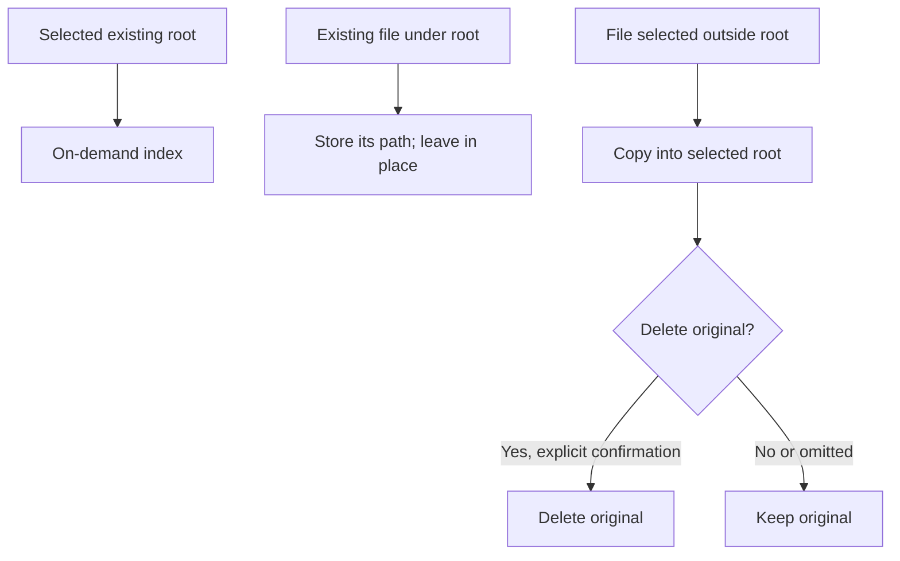
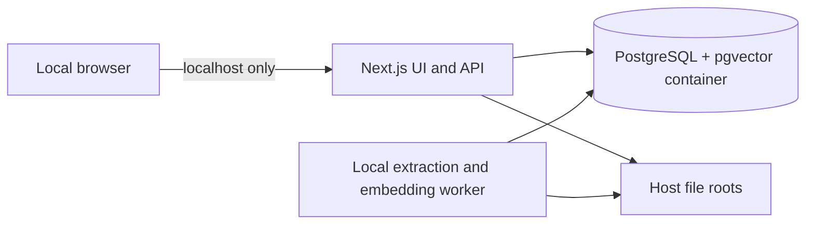

# Personal Digital Archive Design

## Decisions

- Local, single-user Next.js app; no login or hosted services.
- PostgreSQL is the source of truth and pgvector stores one 384-dimensional vector per chunk.
- Files stay on the host disk. Indexing is limited to one selected root, defaulting to the existing `Downloads` directory under the operating-system home/profile directory.
- Users can change the root to Documents or another existing directory within their home/profile, including the profile directory itself. Do not scan every home subdirectory unless the user selects the home directory as the root.
- Files under the selected root are indexed in place. Importing a file outside the root copies it into the root, then asks whether to delete the original; the default is no.
- Development uses the current PostgreSQL 18 pgvector Docker image. PostgreSQL production hosting remains undecided.
- The app makes no external network requests. All API traffic is local; dependencies, fonts, and OCR assets are served from local installation files.

## Paths and local storage

Resolve home/profile using Node's `os.homedir()` and platform path utilities. The default root is `<home>/Downloads`; do not assume `C:\` is the Windows home. If Downloads does not exist, require the user to select an existing root instead of creating it silently. The selected root must resolve to an existing directory. The database container stores only PostgreSQL data; its volume is a host directory. Binary files are read and written by the local Next.js server on the host filesystem, not inside that container.

For any path-based API, resolve the path and verify containment under the configured root before reading, indexing, copying, or deleting. Use canonical/real paths to reject traversal and symlink escapes. A file import outside the selected root is copied into it first. Show a confirmation with the original path before deletion; cancellation or omission leaves the original intact.

## Runtime architecture

Keep DB credentials and filesystem operations in server-only modules. Use parameterized SQL, explicit transactions for related updates, and a local worker for long-running extraction/embedding. Do not load remote fonts, scripts, analytics, model assets, or APIs. Postman collections use only a configurable localhost base URL and can be imported/exported as local JSON files.

## Frontend pages

| Page | Purpose |
| --- | --- |
| `/` | Recent items, favorites, and processing status |
| `/items` | Browse, sort, and filter items |
| `/items/new` | Add/upload or index files under the selected root |
| `/items/{id}` | Metadata, tags, collections, status, file access, edit/delete |
| `/search` | Keyword, semantic, and hybrid search |
| `/collections` | Nested collection tree and contents |
| `/tags` | Tags and tagged items |
| `/activity` | Recently accessed items and search history |
| `/reports` | FR17 reports and FR18 statistics |

The initial layout is desktop-first and compact: navigation, search, filter controls, and an item list showing title, format, added date, favorite/archive state, and extraction status. Keep empty, loading, and error states clear. Render only locally bundled assets.

## API contract

Base path: `/api`. JSON except file responses. IDs are SQL identifiers. Standard error shape: `{ "error": { "code": string, "message": string } }`.

### Initial backend checkpoint

| Method and path | Request | Response | Behavior |
| --- | --- | --- | --- |
| `GET /items` | `q?`, `formatId?`, `tagId?`, `collectionId?`, `dateFrom?`, `dateTo?`, `favorite?`, `archived?`, `limit?`, `offset?` | `{items, total}` | Browse/filter items; no semantic or keyword search in this checkpoint |
| `GET /items/{id}` | — | `{item, chunks?, collections, tags}` | Read item and record access |
| `PATCH /items/{id}` | Editable metadata, favorite/archive values, `collectionIds?`, `tagIds?` | `{item}` | Update metadata and complete collection/tag memberships |
| `GET /collections` | `tree?` | `{collections}` | Return nested collection data |
| `POST /collections` | `{name, parentId?}` | `201 {collection}` | Create collection |
| `PATCH /collections/{id}` | `{name?, parentId?}` | `{collection}` | Rename or move; reject cycles |
| `DELETE /collections/{id}` | — | `204` | Delete; SQL cascades item memberships and child collections |
| `GET /tags` | `q?` | `{tags}` | List tags and usage counts |
| `POST /tags` | `{name}` | `201 {tag}` | Create a free-form tag |

### Later backend APIs

| Method and path | Purpose |
| --- | --- |
| `POST /items` | Add/upload or import a file, extracting and chunking atomically |
| `DELETE /items/{id}` | Delete item; retain trigger audit and SQL cascades |
| `POST /search` | Keyword, semantic, or hybrid search; append search history |
| `GET /activity/recent` | Recently accessed items |
| `GET /activity/searches` | Search history |
| `GET /reports/{name}` | Allowlisted FR17 reports and FR18 statistics |
| `GET /items/{id}/file` | Stream only a file inside the selected root |
| `POST /scan` | Start a local scan of the selected root |
| `GET /scan/{scanId}` | Read local scan progress |

## Backend behavior

- Item list/detail/update use existing `item`, `file_format`, `chunk`, `item_collection`, `collection`, `item_tag`, and `tag` tables. Read filters are parameterized; list responses include stable pagination and total count.
- Detail reads append to `access_log`. PATCH updates only provided item fields; supplied collection/tag ID arrays replace the corresponding memberships in one transaction.
- Collection moves must reject self-parenting and descendant cycles before update. SQL's own-parent check alone does not prevent longer cycles.
- Collection/tag create operations normalize and validate names, translate SQL unique/check violations to 409/400, and return the created row.
- Keyword/filter search later calls `search_items` where its date semantics fit. Semantic and hybrid search query pgvector and join `chunk` to `item`; embedding query vectors must use the configured model and dimension.
- Imports later index files only beneath the selected root. For external files, copy to a collision-safe destination under the root, confirm before deleting the original, and default deletion to false.

## Local extraction choice

Use JavaScript/TypeScript tooling compatible with Next.js rather than a remote service or heavyweight sidecar:

- PDF.js (`pdfjs-dist`) extracts embedded PDF text locally.
- Tesseract.js performs OCR on images and rendered scanned PDF pages. Bundle its worker, WASM core, and selected language data locally; do not fetch them from a CDN or download them at runtime.
- Use small local parsers for DOCX/PPTX/XLSX/CSV/HTML/TXT/MD. Keep format parsers behind an extraction adapter so each can be replaced independently.

This is text extraction/OCR, not image captioning or visual semantic understanding. No vision model is required by the current SRS. OCR/model assets should be limited to selected languages and installed ahead of offline use. Extraction implementation is deferred past the current API checkpoint.

## Database files and migrations

- `db/01_ddl.sql` is the complete canonical schema snapshot.
- `db/02_dml.sql` remains the course demonstration script; it is not run during setup because it includes destructive examples. `db/seed.sql` inserts safe format lookup rows.
- `db/migrations/` contains ordered, additive changes with one migration per checkpoint. The API uses a migration ledger so already-applied changes are not rerun.
- Keep the snapshot current with migrations; a new database is initialized from the snapshot, then later migrations are applied in order only where necessary. Never put the final schema snapshot under `migrations/`.
- Development compose mounts PostgreSQL data on the host and does not mount archive files into the DB container.

## SQL alignment issues to resolve

- `add_item` does not accept collection/tag memberships; later ingest must add these inside the same surrounding transaction or extend the procedure.
- `embedding_worker` needs `INSERT` on `embedding`; the current DDL grants it, and canonical role behavior must remain aligned across migrations and snapshots.
- Current DDL has `archive_app` broad DML on many tables. Restrict API query paths to intended operations; revisit grants if runtime SQL is moved to a narrower app role.
- `search_items` filters by `added_at`, while an example report filters `created_at`; finalize date semantics when search is implemented.

## Checkpoint boundary

The first implementation ends after the nine initial API operations in the table above, database setup/migration foundations, and Basic/Exhaustive Postman collections. Ingest, file lifecycle, search, workers, activity, reports, frontend pages, and semantic embeddings remain for the next contributor.
